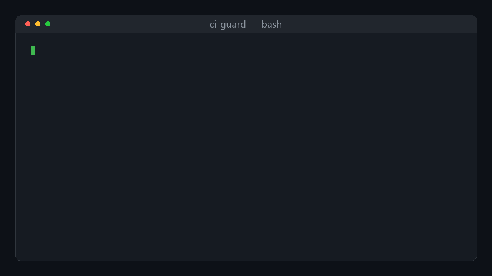

# ci-guard

**把团队写好的 CI 规范，变成会在提交时说「不」的门禁。** 17 条判据、29 KB 单文件、纯 Python、零运行时依赖（除 pyyaml），跑在 GitHub Actions 里，只拦新增、不追旧账。

[](https://github.com/qiuqianyi66/ci-guard-live/actions/workflows/guard.yml)



<sub>English keywords: GitHub Actions security checker · pin actions to commit SHA · policy-as-code gate · SARIF 2.1.0 · CI compliance</sub>

---

## 这是什么

`ci-guard` 是一个 GitHub Actions 静态检查器。它读 `.github/workflows/` 下的 YAML，按 17 条判据逐条判定，输出三种格式（文本 / JSON / SARIF 2.1.0），并以分级退出码阻断流水线。

它的判据不是拍脑袋来的，每一条都挂在《企业级 AI Native 项目开发全流程白皮书》附录 AV–AW 的具体条款上（AV.5、AV.6、AW.7、AW.8、AW.10……）。

**它不是什么**：不是 linter 的替代品，不是安全扫描器，不是 SaaS，不需要上传任何代码。

---

## 它解决三个具体问题

**一、规范写在文档里，但没人在提交时执行。**
团队通常有《研发安全基线》《发布流程管理办法》，条款几十条，一条都不会在 `git push` 时生效。ci-guard 把其中**能机器判定的部分**翻成判据。

**二、存量问题太多，一上新门禁就红一片，第一件事就是被删掉。**
所以第一次接入先冻结存量（`--init-config` 生成基线），只拦新增。修一条，基线自动少一条，门只会越来越紧。

**三、通用工具判不了「你们自己的规矩」。**
actionlint 判语法与语义对错，zizmor 判通用安全模式。它们不知道你们规定「Pages 部署不允许并发取消」——而这恰好是白皮书 AV.5 自己写下的条款。

---

## 30 秒接入

```bash
# 1. 本地先看一遍（不装任何东西，只要 python + pyyaml）
pip install pyyaml
python tools/ci-guard/ci_guard.py .

# 2. 冻结当前存量，让 CI 先变绿
python tools/ci-guard/ci_guard.py . --init-config

# 3. 之后 CI 只跑这一行
python tools/ci-guard/ci_guard.py . --baseline .ci-guard-baseline.json
```

工作流模板：

```yaml
name: ci-guard
on: [push, pull_request]
permissions:
  contents: read
jobs:
  guard:
    runs-on: ubuntu-latest
    steps:
      - uses: actions/checkout@11bd71901bbe5b1630ceea73d27597364c9af683 # v4.2.2
      - run: pip install pyyaml==6.0.3
      - run: python tools/ci-guard/ci_guard.py . --baseline .ci-guard-baseline.json
```

新手请走 [GETTING-STARTED.md](tools/ci-guard/GETTING-STARTED.md)：每一步都有预期输出和踩坑说明。

---

## 17 条判据

| 编号 | 级别 | 判什么 | 依据 |
|---|---|---|---|
| R01 | FAIL / high | action 未 pin 到 40 位 SHA | AV.6 |
| R02 | WARN / low | shell 有管道但没 `pipefail` | AU.3 / AV.13 |
| R03 | FAIL / high | Pages 部署可被并发取消 | AV.5 / AW.9 |
| R04 | WARN / medium | 内容类写权限发给了多个 job | AW.7 |
| R05 | WARN / medium | 顶层与 job 级都没有 `permissions` | AW.7 |
| R06 | WARN / medium | Pages 部署无 fork 守卫 | AW.8 |
| R07 | WARN / low | cron 落在整点 | AW.9 |
| R08 | WARN / medium | 不变量检查只在 PR 侧 | AW.5 |
| R09 | WARN / medium | `@latest`、pip 未钉版本 | AU.9 / AV.9 |
| R10 | FAIL / high | secrets 直接进 `run` | AU.10 |
| R11 | WARN / low | 发布 job 没有 `needs` | AU.6 / AW.7 |
| R12 | FAIL / high | 嵌套 module 无覆盖 | AW.3 |
| R13 | WARN / medium | 仓库完全没有 workflow | AV.2 |
| R14 | WARN / medium | 发布路径里的文件在 PR 侧没有检查 | AW.8 |
| R15 | FAIL / high | `pull_request_target` 下 checkout PR head，或显式打开 `allow-unsafe-pr-checkout` | AW.10 / AU.10 |
| R16 | FAIL / high | `permissions: write-all` | AW.7 |
| R17 | WARN / low | 自托管 runner 跑 PR 代码 | AV.10 |

逐条的症状、为什么、怎么修、误报边界在 [docs/RULES.md](tools/ci-guard/docs/RULES.md)。

---

## 它不是又一个 lint

| | actionlint | zizmor | ci-guard |
|---|---|---|---|
| 判什么 | 语法 / 语义对错 | 通用安全模式 | 团队自己写下的判据 |
| 检查项 | 36 类 | 34 条 audit | 17 条 |
| 和本工具重叠 | — | — | 7 条重叠、6 条独有、3 条部分重叠 |
| 存量治理 | 无 | 无 | 基线冻结 + 棘轮 |
| 目标格式 | 文本 | SARIF | 文本 / JSON / SARIF |

结论：三者判的不是同一件事。actionlint 管对错，zizmor 管安全，ci-guard 管「符不符合你们自己的规矩」。完整对照见 [COVERAGE.md](tools/ci-guard/COVERAGE.md)。

---

## 棘轮：只拦新增，不追旧账

在真实 GitHub 仓库（[ci-guard-live](https://github.com/qiuqianyi66/ci-guard-live)）上跑过四次：

| 次 | 动作 | 结果 | 耗时 |
|---|---|---|---|
| 1 | 直接接上，不冻结 | failure（报 2 条存量） | 8s |
| 2 | `--init-config` 冻结 2 条 | **success**（0 新增） | 9s |
| 3 | 注入一条新增违规 | failure（**只报新增那 1 条**） | 10s |
| 4 | 升级 checkout 到 v5.1.0（node24） | success，Node 20 弃用告警消失 | 18s |

第 3 次 GitHub 采到的 annotation 只有一条，落在 `.github/workflows/demo.yml:13`——存量那两条没有复现。

---

## 常见问题

**Q：和 actionlint、zizmor 是什么关系？要不要一起用？**
一起用。它们负责通用正确性与安全，ci-guard 负责你们自己的条款。重叠的 7 条可以只留一边。

**Q：会不会误报太多？**
第一版在成熟范本仓报了 4 条，逐条读原文后发现全是误报（把 Pages 部署必需的 `pages: write` 当成越权、把 PR 侧文档构建当成部署面、把预演 job 当成缺依赖、把 jq 程序内部管道当成 shell 管道）。改判定与兜底豁免后，范本仓才做到 0 误报。**没有承诺「零误报」，承诺的是每条误报都有边界说明、并且会被改掉。**

**Q：存量问题太多，一接上就红一片怎么办？**
先冻结，别急着修。`--init-config` 把当前状态记成基线，CI 先绿；之后每修一条，忽略数自动减一。真实数据：tea 36 条 → 改一行 `cancel-in-progress: false` 后变 35 条。

**Q：私有仓库能把结果上传到 GitHub 的 code scanning 面板吗？**
不能。那个功能要付费的 GitHub Advanced Security。本工具的交付方式是 **PR 拦截 + 本地 SARIF 文件**，SARIF 已通过官方 2.1.0 schema 严格校验（离线 schema，112 KB）。

**Q：为什么必须 pin 到 commit SHA，pin tag 不行？**
tag 是可变的。上游把 `v4` 指向另一份代码，你的流水线第二天就在跑别人的代码，而你的仓库里什么都没变。SHA 不可变。

**Q：支持 GitLab CI / Jenkins 吗？**
不支持。判据与规则引擎是通用的，但目前只实现了 GitHub Actions 的解析层。

**Q：需要付费、注册或上传代码吗？**
都不需要。一个 Python 脚本，在你自己的 runner 上跑，只看 `.github/workflows/`。

**Q：怎么知道它真有用？**
三次真实运行记录、四仓体检数字、误报校准过程都在 [ADOPT.md](tools/ci-guard/ADOPT.md) 与 [AUDIT 报告](tools/ci-guard/README.md) 里，可以逐条核。它抓出的最典型一处：一个仓的 Pages 部署挂了 `cancel-in-progress: true`，一次新提交就能把正在跑的部署打断成半成品。

---

## 可核验的事实

- 17 条判据，每条对应白皮书附录 AV–AW 的具体条款
- 主程序 29 KB，单文件 Python，只依赖 pyyaml
- 三个真实仓库扫描合计 55 条 FAIL（另有一个成熟范本仓 0 FAIL）
- 真实 GitHub 仓四次运行：8s / 9s / 10s / 18s
- SARIF 通过官方 2.1.0 schema 校验（19 results）
- 自带回归测试 7 项：坏样本覆盖 16/17（R13 空仓单独验）、合规样本 0 命中、基线冻结后 0 残留

---

## 文档地图

| 文件 | 内容 |
|---|---|
| [GETTING-STARTED.md](tools/ci-guard/GETTING-STARTED.md) | 新手 30 分钟：从看懂 workflow 到接进 CI |
| [docs/RULES.md](tools/ci-guard/docs/RULES.md) | 17 条逐条：症状 / 为什么 / 怎么修 / 误报边界 |
| [COVERAGE.md](tools/ci-guard/COVERAGE.md) | 与 actionlint、zizmor 的目录级对照 |
| [ADOPT.md](tools/ci-guard/ADOPT.md) | 接入演练、真实运行记录、应急路径、已知坑 |
| [ONEPAGER.md](tools/ci-guard/ONEPAGER.md) | 一页纸：三个真实命中 + 成本 |
| [FDE-NOTES.md](tools/ci-guard/FDE-NOTES.md) | 一线交付视角下的能力与缺口 |
| [selftest.py](tools/ci-guard/selftest.py) | 7 项回归，含 SARIF schema 校验 |
| [verify_sarif.py](tools/ci-guard/verify_sarif.py) | 官方 schema 离线校验器 |

---

## 边界

- 只读 `.github/workflows/`，不修改任何业务文件
- 不做 SaaS、不做后台、不需要账号
- 不承诺零误报，承诺误报会被记录并修掉
- 私有仓的 code scanning 面板不可用（需 Advanced Security）
- 只有 GitHub Actions 解析层

## 使用

MIT。拿去改，改了记得把误报改回来。

---

**如果这套东西对你有用**：给一个仓库地址（[开一个诊断 issue](https://github.com/qiuqianyi66/ci-guard-live/issues/new/choose)），24 小时内出一份逐条报告，免费，不需要权限。
